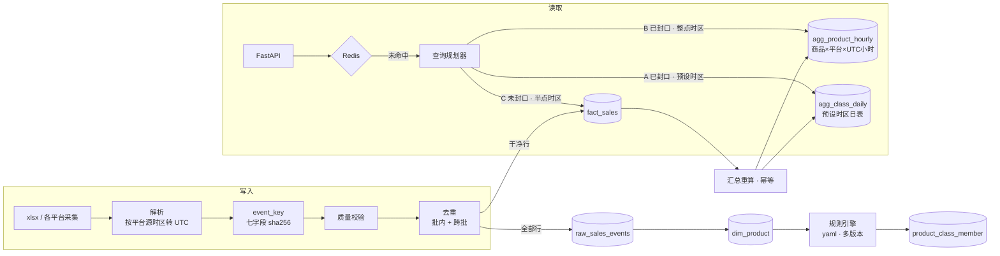

# sales-trend · 销售数据趋势查询与 API

万悉科技笔试题一：从多平台销售明细里，按任意日期区间、一个或多个平台、任意时区，返回「maxi dress」的日销量趋势，并在大数据量、高并发下保持可用。

## 三条命令跑起来

```bash
make up      # 起 ClickHouse 24.8、Redis 7、API 三个容器（需要 Docker）
make seed    # 建表 → 导入 xlsx → 去重与质量校验 → 品类识别 → 汇总重算
make demo    # 10 条典型请求与真实响应
```

然后打开 <http://localhost:8000/docs> 交互式调用；<http://localhost:8000/metrics> 是 Prometheus 指标（多 worker 汇总，口径见 [design.md §7.2](docs/design.md)）。其他命令：

| 命令 | 做什么 |
|---|---|
| `make test` | 单元 + 集成测试（集成测试连真 ClickHouse，需要先 `make up && make seed`） |
| `make report` | 重新生成[数据质量报告](docs/data-quality-report.md)（不需要数据库） |
| `make ingest` | 把同一文件再导一次，演示跨批去重：fact 行数不变 |
| `make perf` | k6 固定到达率压测（P1–P4、P6），生成[压测报告](docs/perf-report.md)（需要本机装 k6） |
| `make perf-p5` | 千万级实测：独立库 `p5` 合成 1000 万行明细，测存储、重算、三段查询与端到端，测完删库（`KEEP=1` 保留） |
| `make perf-p6` | 只跑 P6：任意区间命中率，附 20 个热点 key 的对照 |
| `make down` | 清理容器与数据 |

## 结果一览（样例数据，去重后）

| 口径 | 值 |
|---|---|
| maxi dress 命中商品 | 2001–2012，共 12 个 |
| 总销量（UTC） | **1117**：app 368 · marketplace 372 · website 377 |
| 分月（UTC） | 1 月 484 · 2 月 445 · 3 月 188 |
| 分月日均（UTC） | 15.6 · 15.3 · 14.5（3 月只覆盖 1–13 号，`partial: true`；合计 188 不是「崩了」） |
| 2 月合计，按 Asia/Shanghai 出报表 | **取决于源时区**：源时间若是 UTC，为 415（跨月探针行换日）；源时间若本来就是北京时间，为 445，与原样切日相同。源时区尚未确认，所以这个请求会带 `SOURCE_TZ_UNCONFIRMED` 警告 |
| 原始 300 行 | 12 行整行重复，fact 288 行 |
| 边界商品 | Maxi Skirt 排除 · Elegant Long Dress 待审不计入 · T-shirt Dress 类目冲突告警 |
| 数据截止 | 按平台推断：app 03-13 09:45Z · website 03-12 18:05Z · marketplace 03-11 15:15Z；各平台截止之后返回 `null` 而不是 `0` |

这些数字全部写在 [`tests/golden/expected.json`](tests/golden/expected.json)，集成测试经 API 全链路逐条断言。

**千万级实测（P5，合成 1000 万行明细，4 vCPU 虚拟机，详见[压测报告](docs/perf-report.md)）**：

| 项 | 结果 |
|---|---|
| 存储 | 明细 427 MB（压缩比 1.36，随机 event_key 占大头）· 商品小时表 945 万行 63 MB（4.35）· 品类日表 6,588 行 |
| 重算 | 全年小时表 7.0 s；品类日表每个预设时区全年 0.3–1.6 s |
| 日表段 · 一年 | P99 串行 2 ms / 8 并发 11 ms ✅（目标 150） |
| 明细段 · 31 天 | P99 串行 61 ms / 8 并发 470 ms ✅（目标 1500） |
| 小时表段 · 一年 | P99 串行 173 ms ✅ / **8 并发 1,248 ms ❌**（目标 500）；吞吐上限约 7.8 QPS，16 并发内存超限 |
| 端到端（小时表一年，缓存旁路） | 5 RPS P99 160 ms ✅；10 RPS 超过吞吐上限，56% 超时 |
| 缓存命中率 | 20 个热点 key 99.8%；任意区间（P6）只有 11.2% |

## 架构



**三个关键设计**：

1. **去重必须在聚合之前**。ClickHouse 的去重是最终一致的，物化视图会在插入时就把重复行聚合进去，事后撤不回来。所以去重在写入管线里做完，表引擎只做兜底。
2. **汇总存「商品 × 平台 × UTC 小时」**。品类在查询时由带版本的规则决定，改规则不用重算；日界在查询时按时区切，换时区不用重算。
3. **查询规划器分三段读**：已封口的读汇总，未封口的读明细，并且把时区纳入分段条件。响应 `meta.plan` 回显每段读了哪张表。

完整说明（每个选型的「为什么 / 反方 / 何时换」）见 **[docs/design.md](docs/design.md)**。

## 接口

```
GET /v1/product-classes/{class_slug}/sales-trend
    ?start_date=2024-01-01&end_date=2024-03-31   # 闭区间，最多 366 天
    &platforms=app,website                       # 可选，默认全部
    &tz=Asia/Shanghai                            # IANA 名，默认 UTC
    &granularity=day                             # day | week | month
    &rule_version=v1                             # 可选，默认当前版本
```

```json
{
  "data": {
    "dates":  ["2024-01-01", "2024-01-02", "2024-01-03", "…", "2024-03-31"],
    "series": [
      {"platform": "app",         "values": [10, 13, 0, "…", 0,    0,    null]},
      {"platform": "marketplace", "values": [0,  0,  7, "…", null, null, null]},
      {"platform": "website",     "values": [19, 0,  0, "…", 6,    null, null]}
    ],
    "total": [29, 13, 7, "…", 6, 0, null]
  },
  "meta": {
    "tz": "UTC", "rule_version": "v1", "granularity": "day",
    "data_through": "2024-03-13T09:45:00Z",
    "data_through_by_platform": {"app": "2024-03-13T09:45:00Z", "marketplace": "2024-03-11T15:15:00Z",
                                 "website": "2024-03-12T18:05:00Z"},
    "partial_dates": ["2024-03-11", "2024-03-12", "2024-03-13"],
    "source_tz_assumed": true,
    "warnings": [],
    "sum": {"app": 368, "marketplace": 372, "website": 377, "all": 1117},
    "plan": [
      {"segment": "class_daily", "table": "agg_class_daily", "from": "2024-01-01", "to": "2024-03-12"},
      {"segment": "fact",        "table": "fact_sales",      "from": "2024-03-13", "to": "2024-03-13"}
    ],
    "cache": "miss", "stale": false
  }
}
```

上例省略号后三列是 03-12、03-13、03-31。字段口径：

| 字段 | 含义 |
|---|---|
| `values` 里的 `0` / `null` | `0` = 没卖出去；`null` = 晚于**该平台**的数据截止，还不知道 |
| `total` | 选中平台全部为 null → null；部分为 null → 非 null 平台之和，并把这一天记入 `partial_dates` |
| `meta.data_through_by_platform` | 各平台截止时间，**从该平台最新事件推断**。生产应换成采集侧心跳与接收水位：平台某天真的零销量时，推断值会把它误判成 null |
| `meta.partial_dates` | 不完整的本地日：含某个平台的截止时刻，或部分平台已为 null |
| `meta.source_tz_assumed` | 选中平台里有源时区**未与采集方确认**的（样例三个平台都是） |
| `meta.warnings` | 不影响返回的提示，没有时为 `[]`。请求 `tz` 与未确认的源时区不同时带 `{"code": "SOURCE_TZ_UNCONFIRMED", "message", "platforms", "source_tz"}`：换算可能引入整体偏移 |

`granularity=week|month` 时，`data` 下再加四个与 `dates` 平行的数组（仍是列式；`day` 粒度不带）：

| 字段 | 含义 |
|---|---|
| `days_in_bucket` | 桶本身的天数：周 7，月 28–31，不受查询区间裁剪 |
| `days_covered` | 桶内落在查询区间、且不晚于数据截止的天数。「数据截止」取选中平台里最晚的一个；截止当天虽不完整，也算一整天 |
| `partial` | `days_covered < days_in_bucket`，或桶内含 `partial_dates` 里的日 |
| `daily_avg` | `total / days_covered`，保留一位小数；`days_covered` 为 0 时为 null。只给 total 的日均，不给按平台的日均：各平台截止不同，按平台日均要用各自的覆盖天数（例如 marketplace 3 月只有 11 天），需要时用 `data_through_by_platform` 自行折算 |

```json
"data": {"dates": ["2024-01-01", "2024-02-01", "2024-03-01"], "total": [484, 445, 188],
         "days_in_bucket": [31, 29, 31], "days_covered": [31, 29, 13],
         "partial": [false, false, true], "daily_avg": [15.6, 15.3, 14.5], "series": ["…"]}
```

错误体遵循 RFC 9457（`application/problem+json`），11 个错误码，每个都有测试：

```json
{"type": "https://salestrend.example.com/problems/invalid-tz", "title": "Invalid time zone", "status": 400,
 "detail": "tz: '+08:00' is not an IANA time zone name, e.g. Asia/Shanghai", "code": "INVALID_TZ",
 "invalid_params": [{"name": "tz", "reason": "'+08:00' is not an IANA time zone name, e.g. Asia/Shanghai"}]}
```

完整定义见 [docs/openapi.json](docs/openapi.json)（`TrendResponse` schema 带逐字段说明）；`make demo` 打印 10 条真实请求与响应。

## 交付物对照

| 题面要求 | 位置 |
|---|---|
| maxi dress 识别 / 归一化规则 | [rules/maxi_dress.v1.yaml](rules/maxi_dress.v1.yaml) · [design.md §3.3](docs/design.md) · v3 影子版本（中心词 + 长度槽分档，32 条对抗用例）见 [docs/classification-v3.md](docs/classification-v3.md) |
| 存储方案、schema、索引 | [sql/ddl/001_tables.sql](sql/ddl/001_tables.sql) · [design.md §1–2](docs/design.md) · ES 等价方案 [es/](es/README.md) |
| 核心查询（按日期、平台分组） | [sql/queries/](sql/queries/) 三段 · [sql/rollup/](sql/rollup/) 汇总重算 |
| RESTful API 与错误处理 | [src/salestrend/api/](src/salestrend/api/) · [docs/openapi.json](docs/openapi.json) |
| 大数据量与高并发 | [design.md §4–7](docs/design.md) · [压测报告](docs/perf-report.md) |
| 重复、标题归一化、时区、异常记录 | [design.md §3](docs/design.md) · [数据质量报告](docs/data-quality-report.md)（8 行探针逐条结论） |

## 代码结构

```
src/salestrend/
├── ingest/pipeline.py     解析、源时区、event_key、质量校验、去重（纯函数）
├── classify/rules.py      标题归一化、规则引擎、多版本
├── query/planner.py       三段查询规划（纯函数）
├── store.py               ClickHouse：建表、写入、汇总重算、三段查询
├── service.py             缓存 → singleflight → 规划 → 执行 → 补零 → 降级
├── api/                   FastAPI 路由、参数校验、RFC 9457 错误体
├── cache/resilience.py    Redis 缓存、singleflight、令牌桶、熔断
└── report/quality.py      数据质量报告
tests/unit                 归一化、规则、管线、规划器、11 个错误码、缓存与降级（假存储，不需要数据库）
tests/integration          真 ClickHouse 黄金值、三条路径对拍、重算幂等
```

## 已知局限与下一步

- **源时区未确认**：三个平台暂按 UTC 解析（`config/platforms.yaml` 里 `confirmed: false`），等于按时间戳上写的日期原样切日。请求别的 `tz` 时响应带 `SOURCE_TZ_UNCONFIRMED` 警告，不拒绝。确认后改配置并重放；采集契约应要求时间戳带偏移量（见 [design.md §3.1](docs/design.md)）。
- **各平台截止时间是推断的**：已按各平台自己的截止时间判 null（marketplace 03-12 起、website 03-13 起为 null），但截止时间取自该平台最新事件。平台某天真的零销量时会被误判成 null；生产要靠采集侧心跳与接收水位。
- **小时表段不扛并发**（P5 实测）：一年区间单查询 173 ms，但商品小时表在稀疏数据下行数接近明细、品类过滤跳不过 granule，每次都是全表扫描，4 vCPU 上吞吐封顶约 7.8 QPS，8 并发 P99 1.2 s 未达标。主要成本是 FINAL（去掉后 8 并发 P99 298 ms、结果一致）。建议：重算改为整分区原子替换后去掉小时表段的 FINAL；为默认规则版本加一张品类小时表。见[压测报告](docs/perf-report.md) P5 与 [design.md §2](docs/design.md)。
- **任意区间的缓存命中率低**（P6 实测 11.2%）：缓存按整个响应做，命中率取决于用户选区间的方式。未命中多数落在毫秒级的日表段；风险在「任意区间 + 非预设整点时区」。下一步是把缓存粒度下沉到日格子。
- **singleflight 与限流是进程内的**：多实例部署时，singleflight 锁与令牌桶应放到 Redis 或网关。
- **重算任务没有接调度器**：演示用 `make seed` 一次性重算；生产按「每 5 分钟最近 3 小时、每天最近 2 天」接 cron 或调度系统。
- **没有鉴权**：只按 `X-API-Key` 头做限流分桶演示。
