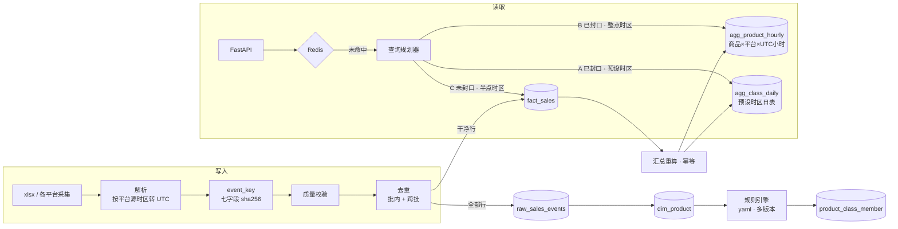

# sales-trend · 销售数据趋势查询与 API

万悉科技笔试题一：从多平台销售明细里，按任意日期区间、一个或多个平台、任意时区，返回「maxi dress」的日销量趋势，并在大数据量、高并发下保持可用。

## 三条命令跑起来

```bash
make up      # 起 ClickHouse 24.8、Redis 7、API 三个容器（需要 Docker）
make seed    # 建表 → 导入 xlsx → 去重与质量校验 → 品类识别 → 汇总重算
make demo    # 8 条典型请求与真实响应
```

然后打开 <http://localhost:8000/docs> 交互式调用。其他命令：

| 命令 | 做什么 |
|---|---|
| `make test` | 单元 + 集成测试（集成测试连真 ClickHouse，需要先 `make up && make seed`） |
| `make report` | 重新生成[数据质量报告](docs/data-quality-report.md)（不需要数据库） |
| `make ingest` | 把同一文件再导一次，演示跨批去重：fact 行数不变 |
| `make perf` | k6 固定到达率压测，生成[压测报告](docs/perf-report.md)（需要本机装 k6） |
| `make down` | 清理容器与数据 |

## 结果一览（样例数据，去重后）

| 口径 | 值 |
|---|---|
| maxi dress 命中商品 | 2001–2012，共 12 个 |
| 总销量（UTC） | **1117**：app 368 · marketplace 372 · website 377 |
| 分月（UTC） | 1 月 484 · 2 月 445 · 3 月 188 |
| 2 月合计，按 Asia/Shanghai 出报表 | 415（跨月探针行换日） |
| 原始 300 行 | 12 行整行重复，fact 288 行 |
| 边界商品 | Maxi Skirt 排除 · Elegant Long Dress 待审不计入 · T-shirt Dress 类目冲突告警 |
| 数据截止 | 2024-03-13 09:45 UTC，之后的日期返回 `null` 而不是 `0` |

这些数字全部写在 [`tests/golden/expected.json`](tests/golden/expected.json)，集成测试经 API 全链路逐条断言。

## 架构



**三个关键设计**：

1. **去重必须在聚合之前**。ClickHouse 的去重是最终一致的，物化视图会在插入时就把重复行聚合进去，事后撤不回来。所以去重在写入管线里做完，表引擎只做兜底。
2. **汇总存「商品 × 平台 × UTC 小时」**。品类在查询时由带版本的规则决定，改规则不用重算；日界在查询时按时区切，换时区不用重算。
3. **查询规划器分三段读**：已封口的读汇总，未封口的读明细，并且把时区纳入分段条件。响应 `meta.plan` 回显每段读了哪张表。

完整说明（每个选型的「为什么 / 反方 / 何时换」）见 **[docs/design.md](docs/design.md)**。

## 接口

```
GET /v1/product-classes/{class_slug}/sales-trend
    ?start_date=2024-01-01&end_date=2024-03-31   # 闭区间，最多 366 天
    &platforms=app,website                       # 可选，默认全部
    &tz=Asia/Shanghai                            # IANA 名，默认 UTC
    &granularity=day                             # day | week | month
    &rule_version=v1                             # 可选，默认当前版本
```

```json
{
  "data": {
    "dates":  ["2024-01-01", "2024-01-02", "2024-01-03", "…", "2024-03-31"],
    "series": [
      {"platform": "app",         "values": [10, 13, 0, "…", null]},
      {"platform": "marketplace", "values": [0,  0,  7, "…", null]},
      {"platform": "website",     "values": [19, 0,  0, "…", null]}
    ],
    "total": [29, 13, 7, "…", null]
  },
  "meta": {
    "tz": "UTC", "rule_version": "v1", "granularity": "day",
    "data_through": "2024-03-13T09:45:00Z",
    "partial_dates": ["2024-03-13"],
    "sum": {"app": 368, "marketplace": 372, "website": 377, "all": 1117},
    "plan": [
      {"segment": "class_daily", "table": "agg_class_daily", "from": "2024-01-01", "to": "2024-03-12"},
      {"segment": "fact",        "table": "fact_sales",      "from": "2024-03-13", "to": "2024-03-13"}
    ],
    "cache": "miss", "stale": false
  }
}
```

错误体遵循 RFC 9457（`application/problem+json`），11 个错误码，每个都有测试：

```json
{"type": "https://salestrend.example.com/problems/invalid-tz", "title": "Invalid time zone", "status": 400,
 "detail": "tz: '+08:00' is not an IANA time zone name, e.g. Asia/Shanghai", "code": "INVALID_TZ",
 "invalid_params": [{"name": "tz", "reason": "'+08:00' is not an IANA time zone name, e.g. Asia/Shanghai"}]}
```

完整定义见 [docs/openapi.json](docs/openapi.json)；`make demo` 打印 8 条真实请求与响应。

## 交付物对照

| 题面要求 | 位置 |
|---|---|
| maxi dress 识别 / 归一化规则 | [rules/maxi_dress.v1.yaml](rules/maxi_dress.v1.yaml) · [design.md §3.3](docs/design.md) |
| 存储方案、schema、索引 | [sql/ddl/001_tables.sql](sql/ddl/001_tables.sql) · [design.md §1–2](docs/design.md) · ES 等价方案 [es/](es/README.md) |
| 核心查询（按日期、平台分组） | [sql/queries/](sql/queries/) 三段 · [sql/rollup/](sql/rollup/) 汇总重算 |
| RESTful API 与错误处理 | [src/salestrend/api/](src/salestrend/api/) · [docs/openapi.json](docs/openapi.json) |
| 大数据量与高并发 | [design.md §4–7](docs/design.md) · [压测报告](docs/perf-report.md) |
| 重复、标题归一化、时区、异常记录 | [design.md §3](docs/design.md) · [数据质量报告](docs/data-quality-report.md)（8 行探针逐条结论） |

## 代码结构

```
src/salestrend/
├── ingest/pipeline.py     解析、源时区、event_key、质量校验、去重（纯函数）
├── classify/rules.py      标题归一化、规则引擎、多版本
├── query/planner.py       三段查询规划（纯函数）
├── store.py               ClickHouse：建表、写入、汇总重算、三段查询
├── service.py             缓存 → singleflight → 规划 → 执行 → 补零 → 降级
├── api/                   FastAPI 路由、参数校验、RFC 9457 错误体
├── cache/resilience.py    Redis 缓存、singleflight、令牌桶、熔断
└── report/quality.py      数据质量报告
tests/unit                 归一化、规则、管线、规划器、11 个错误码、缓存与降级（假存储，不需要数据库）
tests/integration          真 ClickHouse 黄金值、三条路径对拍、重算幂等
```

## 已知局限与下一步

- **时区假设**：三个平台默认按 UTC 解析。小时分布更像本地营业时间，生产须与采集方确认后改 `config/platforms.yaml` 并重放。
- **各平台截止时间不同**：marketplace 最新事件在 03-11，当前按全局截止时间判 null，所以它在 03-12、03-13 显示 0。生产应由采集侧上报各平台的接收水位，按平台判 null。
- **大数据量没有实测**：样例只有 300 行。千万级合成数据下的一年区间小时表查询（压测 P5）这次没有做，设计里的容量与 SLO 是推算值。
- **singleflight 与限流是进程内的**：多实例部署时，singleflight 锁与令牌桶应放到 Redis 或网关。
- **重算任务没有接调度器**：演示用 `make seed` 一次性重算；生产按「每 5 分钟最近 3 小时、每天最近 2 天」接 cron 或调度系统。
- **没有鉴权**：只按 `X-API-Key` 头做限流分桶演示。
