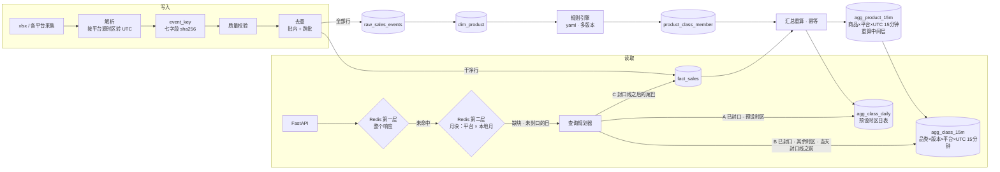

# 交付说明 · 题一 销售数据查询与 API 设计

> 对应版本 **v1.4.0**（`99132a6`）。本文按题面「需要提交」的六项逐项说明：每一项怎么设计、怎么实现、代码在哪、用什么验证。
> 每个选型的完整论证（为什么选 / 反方 / 何时换）在 [design.md](design.md)，本文只给结论与指引；文中数字均取自仓库里的报告与测试。

## 0 · 交付物总览

| # | 题面要求 | 本文 | 仓库位置 |
|---|---|---|---|
| 1 | 系统 / 数据设计说明（可附架构图） | [§1](#1--系统与数据设计说明) | [design.md](design.md) · [architecture.mmd](architecture.mmd) |
| 2 | schema / mapping | [§2](#2--schema--mapping) | [sql/ddl/001_tables.sql](../sql/ddl/001_tables.sql) · [es/mapping.json](../es/mapping.json) |
| 3 | 核心查询 | [§3](#3--核心查询) | [sql/queries/](../sql/queries/) · [sql/rollup/](../sql/rollup/) · [query/planner.py](../src/salestrend/query/planner.py) |
| 4 | API 示例 | [§4](#4--api-示例) | [api/](../src/salestrend/api/) · [openapi.json](openapi.json) · `make demo` |
| 5 | 性能与数据质量说明 | [§5](#5--性能与数据质量说明) | [perf-report.md](perf-report.md) · [data-quality-report.md](data-quality-report.md) · [classification-v3.md](classification-v3.md) |
| 6 | README | [§6](#6--readme) | [README.md](../README.md) |

题面「任务」七条与实现的对应：

| 任务原文 | 落在哪 |
|---|---|
| 返回 maxi dress 日销量趋势，支持 start_date、end_date、一个或多个平台 | §4 接口；另支持 `tz`、`granularity`、`rule_version` |
| 自行定义并说明 maxi dress 识别 / 归一化规则 | §5.1.3 · [rules/](../rules/) 三个版本 |
| 选择存储方案，设计 schema / mapping / 索引 | §1.3、§2 |
| 核心 SQL 或 ES Query，至少按日期、平台分组 | §3（ClickHouse SQL 为主，ES 等价写法见 [es/](../es/README.md)） |
| RESTful API：路径、参数、返回结构、错误处理 | §4 |
| 大数据量与高并发下的优化方案与取舍 | §5.2 |
| 重复数据、标题归一化、timestamp / 时区、异常记录 | §5.1 |

---

## 1 · 系统与数据设计说明

### 1.1 设计目标

题面设定是「多数据源持续采集，前端查任意日期范围、多平台，高并发访问」。据此定了四个目标：

| 目标 | 含义 | 对应设计 |
|---|---|---|
| 口径正确 | 去重、时区、品类判定在任何路径下结果一致 | 写入前去重；按 UTC 存、查询时按 `tz` 切日；规则带版本 |
| 可审计 | 能回答「这个数为什么少了」「这件为什么算 maxi dress」 | raw 表全量保留；每条判定指到规则 id |
| 查询快 | 已聚合数据 P99 50–100 ms 内，含当天实时 ≤ 150 ms（缓存未命中） | 两层 15 分钟汇总 + 三段查询规划 + 两层缓存 |
| 可演进 | 300 行到上亿行，换的是部署而不是模型 | 汇总表很小、与明细量无关；扩展路线见 design.md §7.3 |

### 1.2 架构



**写入链路**（[ingest/pipeline.py](../src/salestrend/ingest/pipeline.py)，纯函数）：解析 → 按平台配置的源时区转 UTC → 计算幂等键 `event_key` → 质量校验 → 批内与跨批去重 → 全部行进 raw、干净行进 fact → 更新商品维表 → 规则引擎输出品类成员 → 定时幂等重算三张汇总表。

**读取链路**（[service.py](../src/salestrend/service.py)）：第一层缓存（整个响应）→ singleflight → 规划整个区间 → 已封口的日从第二层月块拼出，缺块与未封口的日交给规划器查 ClickHouse → 补零、按周 / 月汇总 → 写回缓存 → 返回。存储故障时返回带标记的旧数据，没有旧数据时返回 503 / 504。

### 1.3 存储选型：ClickHouse + Redis

| 维度 | ✅ ClickHouse | PostgreSQL | Elasticsearch |
|---|---|---|---|
| 海量明细聚合 | 主场（列存） | 行存，日增千万吃力 | 可以，耗堆内存 |
| 精确去重 | 最终一致，需要写前去重 | 唯一约束，强 | `_id` 覆盖写 |
| 规则改版重算 | 按区间替换 | 按分区重灌 | 品类写在文档里，要全量重刷 |
| 任意时区切日 | 函数带时区参数 | 可以 | `time_zone` 参数 |
| 运维成本 | 中 | 低 | 中高 |

- **为什么 ClickHouse**：持续多源采集、大数据量下，列存聚合是主场。它的两个短板都能绕开：去重前移到写入管线；品类维表很小，join 代价可以忽略。
- **反方 PostgreSQL**：日增百万以内、或团队只熟 PG 时，按月分区 + BRIN + 汇总表完全够用，运维更省。这是正式备选。
- **已有 ES 时**：题面写的是「可继续使用 Elasticsearch」。[es/README.md](../es/README.md) 给出分工建议（ES 管检索与标题召回，ClickHouse 管销量聚合）和两条改造路线，附等价的 mapping、transform 与查询。
- **Redis**：缓存热点响应与月块。Redis 不可用时一律当作未命中，不影响正确性。

### 1.4 五个关键设计决定

| 决定 | 选择 | 理由 | 依据 |
|---|---|---|---|
| 去重时机 | **写入管线里、聚合之前** | ClickHouse 的 Replacing 去重是后台合并时才发生；物化视图在插入时就把重复行聚合进去，事后撤不回来 | design.md §3.2 |
| 汇总粒度 | **UTC 15 分钟** | 现行全部时区的偏移都是 15 分钟的整数倍（含 +05:45、+08:45），15 分钟格能切准任何时区的日界，非整点时区也不用扫明细 | design.md §2；perf-report「粒度」 |
| 汇总分层 | **商品层只当重算中间层，品类层承接查询** | 品类口径会变、商品销量不会变：改规则只重算品类层（0.2 s）；商品层在稀疏数据下行数接近明细，不能直接查 | design.md §2 |
| 查询规划 | **三段读，一天之内也切** | 已封口读汇总，只有封口线之后的尾巴读明细；时区也纳入分段条件 | design.md §5 |
| 缓存 | **两层：整个响应 + 按月分块** | 只缓存整个响应时，任意区间命中率只有 11.2%；月块让不同区间共享同一批逐日数 | design.md §7.0 |

**一次被实测推翻的判断**：最初只按商品做汇总，查询时按品类成员过滤。在 1000 万行合成数据上，商品 15 分钟层有 9,859,130 行，几乎没压缩行数；品类商品又分散，查一年等于全表扫描，8 并发 P99 1,453 ms。对照实验证明根因是全表扫描、不是 FINAL（合并 part 后带不带 FINAL 是 221 / 237 ms）。于是商品层退为重算中间层，再按规则版本物化一层品类表：一年 70,272 行，8 并发 P99 13 ms（perf-report「小时表段对照实验」）。

---

## 2 · schema / mapping

### 2.1 表结构

DDL：[sql/ddl/001_tables.sql](../sql/ddl/001_tables.sql)，每张表的注释写明了用途与取舍。

| 层 | 表 | 引擎 | 排序键（即主索引） | 分区 | 作用 |
|---|---|---|---|---|---|
| 原始 | `raw_sales_events` | MergeTree | `batch_id, row_no` | 入库月 | 全部原始行（含重复、拒收），只追加，审计用 |
| 事实 | `fact_sales` | ReplacingMergeTree(ingested_at) | **`event_ts`, product_id, event_key** | 事件月 | 干净行；Replacing 只做兜底 |
| 维度 | `dim_product` | ReplacingMergeTree | `product_id` | — | 以 id 为锚，记录全部标题写法与归一化标题 |
| 维度 | `product_class_member` | ReplacingMergeTree | `class_slug, rule_version, product_id` | — | 规则引擎输出：match / exclude / review、命中规则、告警；多版本并存 |
| 汇总 | `agg_product_15m` | ReplacingMergeTree(version) | `product_id, bucket_15m, source` | 月 | 商品 × 平台 × UTC 15 分钟；**重算中间层，不在查询路径上** |
| 汇总 | `agg_class_15m` | ReplacingMergeTree(version) | `class_slug, rule_version, bucket_15m, source` | 月 | 品类 × 规则版本 × 平台 × UTC 15 分钟；B 段热路径 |
| 汇总 | `agg_class_daily` | ReplacingMergeTree(version) | `class_slug, rule_version, tz, local_date, source` | 月 | 预设时区的品类日表；A 段热路径 |
| 状态 | `pipeline_state` | ReplacingMergeTree | `key` | — | 封口水位 `sealed_until`、各平台数据截止 |

核心两张表的 DDL：

```sql
CREATE TABLE fact_sales (
  event_key   String,                      -- sha256(七字段规范化值)
  product_id  UInt32,
  source      LowCardinality(String),
  sales_count UInt32,
  event_ts    DateTime64(3, 'UTC'),        -- 按平台源时区解析后统一存 UTC
  ingested_at DateTime64(3, 'UTC')
) ENGINE = ReplacingMergeTree(ingested_at)
PARTITION BY toYYYYMM(event_ts)
ORDER BY (event_ts, product_id, event_key);

CREATE TABLE agg_class_15m (
  class_slug   LowCardinality(String),
  rule_version LowCardinality(String),
  source       LowCardinality(String),
  bucket_15m   DateTime('UTC'),
  sales        UInt64,
  version      UInt64                       -- 重算批次号
) ENGINE = ReplacingMergeTree(version)
PARTITION BY toYYYYMM(bucket_15m)
ORDER BY (class_slug, rule_version, bucket_15m, source);
```

### 2.2 索引与分区设计

| 设计点 | 选择 | 理由 |
|---|---|---|
| 汇总表排序键 | `class_slug, rule_version` 打头 | 查一个品类只读十几个 granule，与明细量无关：一个规则版本一年至多 3 平台 × 35,136 格 ≈ 10.5 万行（P5 实测 70,272 行） |
| 明细排序键 | `event_ts` 打头（v1.2.0 是 `product_id` 打头） | 明细在查询路径上只剩「全部商品 × 封口线之后的一小段时间」。P5 实测半天尾巴 read_rows 851,115 → 31,915，8 并发 P99 56 → 15 ms，代价是体积 +2.6% |
| 分区 | 一律按月 | ClickHouse 建议分区值在 100–1000 个以内；按天两年就 730 个，容易 Too many parts |
| 低基数列 | `LowCardinality(String)` | 平台、品类、规则版本、时区取值少，按字典编码 |
| 原始时间 | raw 表保留 `ts_raw` 与 `source_tz` | 源时区确认后改配置即可重放，不丢信息 |
| 有符号销量 | raw 表 `sales_count Nullable(Int32)` | 负数、非数字也能入库并被标记拒收 |

### 2.3 Elasticsearch mapping（等价方案，不运行）

[es/mapping.json](../es/mapping.json) 给出明细索引 `sales_events`：3 个分片，`dynamic: strict`；`event_key` 作为幂等的 keyword；`title` 是 text，另带一个 `title.norm` 子字段（keyword，normalizer 为 `lowercase` + `asciifolding`）；`class_slugs` 与 `rule_version` 存品类判定结果；`ts_raw` 只存不索引。[es/transform.json](../es/transform.json) 用连续 transform 把明细汇总成「商品 × 平台 × UTC 小时」索引；[es/query-hourly-lookup.json](../es/query-hourly-lookup.json) 读这个小时汇总索引，用 terms lookup 引用带版本的品类成员文档。

ES 的定位是检索与标题召回。拆连字符、近义词这类更完整的分析链（`word_delimiter_graph`、`synonym_graph` 等）列在 [es/README.md](../es/README.md) 作为召回建议，没有写进 mapping。品类判定仍由规则引擎做，判定结果作为两边共用的 key。

---

## 3 · 核心查询

### 3.1 查询规划：三段读

规划器（[query/planner.py](../src/salestrend/query/planner.py)，纯函数）先把本地日期闭区间逐日换算成 UTC 半开区间（夏令时切换日自然是 23 或 25 小时），再按下表把每一天切成一到两块，首尾相接的同段合并成一次查询：

| 段 | 条件 | 读哪张表 | SQL |
|---|---|---|---|
| A 日表 | `tz` 在预设列表，且该日完整落在 `sealed_until` 之前 | `agg_class_daily` | [trend_daily.sql](../sql/queries/trend_daily.sql) |
| B 15 分钟表 | 其余已封口的部分：非预设时区的已封口日（含 +05:45），以及未封口那天的 `[日始, sealed_until)` | `agg_class_15m` | [trend_class_15m.sql](../sql/queries/trend_class_15m.sql) |
| C 明细 | `[sealed_until, 日终)` 这段尾巴 | `fact_sales` | [trend_fact.sql](../sql/queries/trend_fact.sql) |

三条 SQL 都按 **本地日期 × 平台** 分组，满足题面「至少按日期、平台分组」的要求。

**A 段 · 日表直读**（绝大多数历史查询走这里，每天每平台一行）：

```sql
SELECT local_date, source, sum(sales) AS sales
FROM agg_class_daily FINAL
WHERE class_slug = {cls:String} AND rule_version = {rv:String} AND tz = {tz:String}
  AND local_date >= {d1:Date} AND local_date <= {d2:Date}
  AND source IN {platforms:Array(String)}
GROUP BY local_date, source;
```

**B 段 · 品类 15 分钟表按任意时区切日**（`[s, e)` 是 UTC 半开区间，可以截在一天中间）：

```sql
SELECT toDate(bucket_15m, {tz:String}) AS local_date, source, sum(sales) AS sales
FROM agg_class_15m FINAL
WHERE class_slug = {cls:String} AND rule_version = {rv:String}
  AND bucket_15m >= {s:DateTime('UTC')} AND bucket_15m < {e:DateTime('UTC')}
  AND source IN {platforms:Array(String)}
GROUP BY local_date, source;
```

**C 段 · 明细尾巴**（至多「15 分钟 + 一个重算间隔」）：

```sql
SELECT toDate(event_ts, {tz:String}) AS local_date, source, sum(sales_count) AS sales
FROM fact_sales FINAL
WHERE product_id IN (
        SELECT product_id FROM product_class_member FINAL
        WHERE class_slug = {cls:String} AND rule_version = {rv:String} AND decision = 'match')
  AND event_ts >= {s:DateTime('UTC')} AND event_ts < {e:DateTime('UTC')}
  AND source IN {platforms:Array(String)}
GROUP BY local_date, source;
```

各段结果在应用层按本地日累加（同一天可能分属 B、C 两段），再统一补零、判 null。响应 `meta.plan` 回显每段读了哪张表、覆盖哪些本地日、精确的 UTC 区间：

```json
"plan": [
  {"segment": "class_daily", "table": "agg_class_daily", "from": "2024-01-01", "to": "2024-03-12",
   "utc_from": "2024-01-01T00:00:00Z", "utc_to": "2024-03-13T00:00:00Z"},
  {"segment": "class_15m",   "table": "agg_class_15m",   "from": "2024-03-13", "to": "2024-03-13",
   "utc_from": "2024-03-13T00:00:00Z", "utc_to": "2024-03-13T09:45:00Z"},
  {"segment": "fact",        "table": "fact_sales",      "from": "2024-03-13", "to": "2024-03-13",
   "utc_from": "2024-03-13T09:45:00Z", "utc_to": "2024-03-14T00:00:00Z"}
]
```

### 3.2 汇总重算

[sql/rollup/](../sql/rollup/) 三条，由 [store.py](../src/salestrend/store.py) 的 `rollup` 按顺序执行：商品 15 分钟表（从明细）→ 品类 15 分钟表（从商品层，join 成员表的 match）→ 品类日表（从明细，每个预设时区一份）。

- **定时幂等重算，不用增量物化视图**：物化视图只在插入时触发，重复行一插进来就被聚合；它也只由左表触发，规则变了不会重算。定时重算让迟到数据、去重修正、改规则走同一条路径。
- **整段先删后写，存绝对值**：某个格子被修正成 0 时，新结果里根本没有那一行，只靠 Replacing 覆盖不掉旧行。
- **规则改版**：只重算成员表和两张品类表，商品层与明细都不动。
- **生产节奏**：每 5 分钟重算最近 3 小时，每天重算最近 2 天；`sealed_until` 按 15 分钟对齐。

P5（1000 万行）重算耗时：商品 15 分钟层全年 2.0 s，品类 15 分钟表 0.2 s，品类日表每个预设时区 0.2–0.6 s（README「千万级实测」）。

### 3.3 正确性怎么保证

- **四条路径对拍**（集成测试）：同一请求强制走日表 / 品类 15 分钟表 / 商品 15 分钟表 / 明细，结果必须一致；Berlin、Kathmandu（+05:45）、Eucla（+08:45）、规则 v2 / v3、当天在封口线处切开，都与整段扫明细逐日一致。
- **月块对拍**：经月块拼装的 `data` 与绕过缓存直接计算的结果逐字段相等。单元测试跑 600 个随机请求加 11 类边界（跨月、跨年、夏令时、部分平台 null、当天未封口等）；集成测试在真 ClickHouse + 真 Redis 上跑 222 个请求。
- **黄金值**：样例数据的全部关键数字写在 [tests/golden/expected.json](../tests/golden/expected.json)，经 API 全链路逐条断言。

---

## 4 · API 示例

### 4.1 接口

```
GET /v1/product-classes/{class_slug}/sales-trend
    ?start_date=2024-01-01&end_date=2024-03-31   # 本地日期，闭区间，最多 366 天
    &platforms=app,website                       # 逗号分隔，可选，默认全部
    &tz=Asia/Shanghai                            # IANA 时区名，默认 UTC
    &granularity=day                             # day | week | month，默认 day
    &rule_version=v1                             # 可选，默认当前版本
GET /v1/product-classes                          # 可查品类与规则版本
GET /v1/product-classes/{class_slug}             # 规则全文
GET /v1/meta/freshness                           # 封口水位、各平台数据截止
GET /healthz · /readyz · /metrics
```

| 设计点 | 选择 | 理由 |
|---|---|---|
| 路径 | 品类作为资源 `/product-classes/{class_slug}` | `/maxi-dress-trend` 写死不可扩展；`?keyword=maxi` 每次口径不同，无法缓存与审计 |
| 日期 | 对外闭区间，对内 UTC 半开区间 | 人说「1 号到 31 号」包含 31 号 |
| 时区 | 只接受 IANA 名，不接受 `+08:00` | 固定偏移处理不了夏令时 |
| 出参 | 列式：`dates` + `series[].values` | 图表库直接用，体积约为行式的三分之一 |
| 空值 | `0` 与 `null` 区分 | `0` = 没卖出；`null` = 晚于该平台的数据截止。折线图上 null 断开、0 落地 |
| 不完整周期 | 周 / 月粒度带 `days_covered`、`partial`、`daily_avg` | 3 月只到 13 号，月合计 188 像「崩了」，日均 14.5 其实与前两个月持平 |

完整定义见 [openapi.json](openapi.json)（`TrendResponse` 带逐字段说明），服务起来后 <http://localhost:8000/docs> 可交互调用。

### 4.2 请求与响应

```bash
curl 'localhost:8000/v1/product-classes/maxi-dress/sales-trend?start_date=2024-01-01&end_date=2024-03-31'
```

```json
{
  "data": {
    "dates":  ["2024-01-01", "2024-01-02", "2024-01-03", "…", "2024-03-31"],
    "series": [
      {"platform": "app",         "values": [10, 13, 0, "…", 0,    0,    null]},
      {"platform": "marketplace", "values": [0,  0,  7, "…", null, null, null]},
      {"platform": "website",     "values": [19, 0,  0, "…", 6,    null, null]}
    ],
    "total": [29, 13, 7, "…", 6, 0, null]
  },
  "meta": {
    "tz": "UTC", "rule_version": "v1", "granularity": "day",
    "data_through": "2024-03-13T09:45:00Z",
    "data_through_by_platform": {"app": "2024-03-13T09:45:00Z", "marketplace": "2024-03-11T15:15:00Z",
                                 "website": "2024-03-12T18:05:00Z"},
    "partial_dates": ["2024-03-11", "2024-03-12", "2024-03-13"],
    "source_tz_assumed": true,
    "warnings": [],
    "sum": {"app": 368, "marketplace": 372, "website": 377, "all": 1117},
    "plan": ["… 见 §3.1 …"],
    "cache": "miss", "stale": false
  }
}
```

省略号后的三列是 03-12、03-13、03-31。`granularity=month` 时：

```json
"data": {"dates": ["2024-01-01", "2024-02-01", "2024-03-01"], "total": [484, 445, 188],
         "days_in_bucket": [31, 29, 31], "days_covered": [31, 29, 13],
         "partial": [false, false, true], "daily_avg": [15.6, 15.3, 14.5], "series": ["…"]}
```

换报表时区且源时区未确认时，不拒绝请求，但带提示：

```json
"warnings": [{"code": "SOURCE_TZ_UNCONFIRMED", "message": "…",
              "platforms": ["app", "marketplace", "website"], "source_tz": "UTC"}]
```

`make demo` 打印 10 条典型请求的真实响应。

### 4.3 错误处理

错误体遵循 RFC 9457（`application/problem+json`），带机器可读的 `code` 与 `invalid_params`：

```json
{"type": "https://salestrend.example.com/problems/invalid-tz", "title": "Invalid time zone", "status": 400,
 "detail": "tz: '+08:00' is not an IANA time zone name, e.g. Asia/Shanghai", "code": "INVALID_TZ",
 "invalid_params": [{"name": "tz", "reason": "'+08:00' is not an IANA time zone name, e.g. Asia/Shanghai"}]}
```

| HTTP | code | 触发 |
|---|---|---|
| 400 | `INVALID_DATE` | 日期格式不对 |
| 400 | `RANGE_INVERTED` | start_date 晚于 end_date |
| 400 | `RANGE_TOO_LARGE` | 区间超过 366 天 |
| 400 | `UNKNOWN_PLATFORM` | 平台未登记 |
| 400 | `INVALID_TZ` | 不是 IANA 时区名 |
| 400 | `INVALID_GRANULARITY` | 不是 day / week / month |
| 404 | `CLASS_NOT_FOUND` | 品类不存在（品类列表进程内常驻，不碰存储，防缓存穿透） |
| 404 | `RULE_VERSION_NOT_FOUND` | 规则版本不存在 |
| 429 | `RATE_LIMITED` | 超过令牌桶限额，带 `Retry-After` |
| 503 | `UPSTREAM_UNAVAILABLE` | 存储不可用、熔断中，且没有旧缓存可返回 |
| 504 | `QUERY_TIMEOUT` | 查询超过 2 秒，且没有旧缓存可返回 |

11 个错误码每个都有单元测试。另有几个响应头：`ETag` 配合 `If-None-Match` 返回 304；`X-Cache` 与 `meta.cache` 一致；降级返回旧数据时带 `X-Data-Stale: true`；`Cache-Control: private`（响应按租户区分，不允许 CDN 共享缓存）。

---

## 5 · 性能与数据质量说明

### 5.1 数据质量

逐条结论见自动生成的 [data-quality-report.md](data-quality-report.md)（`make report` 重新生成，不需要数据库）。

**5.1.1 总体口径：只标不删**

| 指标 | 值 |
|---|---|
| 原始行 | 300 |
| 重复行（只进 raw，标 `is_duplicate` 与 `dup_of`） | 12 |
| 拒收行 | 0（校验规则仍然生效，见单测） |
| 进入 fact 的干净行 | 288 |

raw 表保留全部原始行，审计时能回答「这个数为什么少了」。

**5.1.2 重复数据**

- **幂等键**：七个原始字段规范化（去首尾空白、平台与类目小写）后取 sha256。**标题不做归一化**：`Red Maxi Dress` 与 `Red Maxi-Dress` 是两次不同的上报，不能互相去重。
- **批内 + 跨批去重**：跨批时查本批时间窗内 fact 已有的 key。`make ingest` 把同一文件再导一次，fact 行数不变。
- `user_id` 只是模拟字段，不能当幂等键。生产应要求采集方提供 `source + source_event_id`。

**5.1.3 标题归一化与 maxi dress 识别**

归一化四步：小写 → 去所有格 → 标点转空格 → 折叠空格。之后按**词集合**判定，不按子串：`LIKE '%maxi dress%'` 会漏掉 `Maxi Denim Dress`。

规则 v1（默认，[rules/maxi_dress.v1.yaml](../rules/maxi_dress.v1.yaml)）自上而下命中即停：

| 规则 | 条件 | 判定 | 样例 |
|---|---|---|---|
| R2 | 有 skirt / top / pants 等其他品类词，且没有 dress | exclude | Maxi Skirt（98 件）排除；纯关键词方案会多算这 98 件 |
| R1 | 有 maxi，且有 dress / gown / sundress | match | 2001–2012，共 12 个商品 |
| R3 | 只有 long + dress | review，不计入 | Elegant Long Dress（100 件）：long 在 midi 到 maxi 之间都可能 |
| — | 原始类目与标题冲突 | 告警 | T-shirt Dress 类目是 shirt，打 `C1_category_conflict`；类目只做告警，不做必要条件 |

同一 product_id 的多种写法一起判，写法之间判定不一致时降级为 review。

**为什么用规则、不用模糊匹配或大模型**：口径必须可审计，业务问「为什么这件算 maxi dress」时，规则能指到第几条。模糊匹配在这份数据上反而会误判（Maxi Skirt 与 Maxi Dress 的相似度本身就高）。大模型只适合裁决 review 长尾。

**规则版本化**：v1、v2（影子版本，把 long dress 也计入，命中 13 个、1217 件）、v3（影子版本）并存，API 用 `rule_version` 切换。v3（[classification-v3.md](classification-v3.md)）改成先认**中心词**，再按长度词分强、弱、冲突三档：在 32 条对抗用例上 v1 判错 11 条，v3 全部判对；两版在样例数据上命中的是同样 12 个商品。

**5.1.4 timestamp 与时区**

- timestamp 不带时区。每个平台在 [config/platforms.yaml](../config/platforms.yaml) 配一个源时区和「是否已与采集方确认」。解析时转成 UTC 存储，原文保留在 `ts_raw`，确认后改配置即可重放。
- 样例三个平台都是**未确认**，暂按 UTC 解析，等于按时间戳上的日期原样切日。三个平台的时间戳都集中在 07–22 点，像本地营业时间，但看不出是哪个时区。
- 报表时区由请求的 `tz` 决定，入库时不写死日期。数据里有 4 行日界敏感记录（01-31 23:55、02-01 00:05、闰日 02-29 23:50、03-01 00:10），换时区会换日。
- **风险要说出来**：2 月合计按北京时间出报表，源时间若是 UTC 为 **415**，源时间若本来就是北京时间为 **445**。所以请求 `tz` 与未确认的源时区不同时，响应带 `SOURCE_TZ_UNCONFIRMED` 警告（集成测试 `test_source_tz.py` 验证了这两种情况）。
- 生产建议：采集契约要求时间戳带偏移量（ISO 8601），否则夏令时回拨那天 01:00–02:00 无法判断是哪一次。

**5.1.5 异常记录**

| 规则 | 级别 | 处理 |
|---|---|---|
| product_id 非整数 / 时间无法解析 / 销量为负或非数字 / 平台未登记 | 拒收 | 只进 raw |
| 销量超过同商品其他行 P99 的 10 倍 | 告警 | 进 fact，报告列出 |
| 事件时间晚于入库时间 | 告警 | 进 fact，标 `future_ts` |
| 标题与类目冲突 | 告警 | T-shirt Dress 触发 |
| 本地时间 23:30–00:30 | 信息 | 报告专节展示在不同时区下的归属 |

**5.1.6 数据截止：null 与 0**

各平台截止时间不同（app 03-13 09:45Z、website 03-12 18:05Z、marketplace 03-11 15:15Z），接口按平台各自的截止判 null：marketplace 03-12 起、website 03-13 起为 null。这个截止是从该平台最新事件**推断**的，平台某天真的零销量时会被误判；生产应由采集侧上报接收水位来取代它。

出题方埋的 8 行探针（U2091–U2098：跨月、闰日、插词、词序、所有格、边界品类）在报告 §7 逐条给出结论。

### 5.2 性能：大数据量与高并发

**5.2.1 题面列出的五类优化手段，各自怎么做**

| 手段 | 做法 | 关键取舍 |
|---|---|---|
| 索引 | 汇总表 `class_slug, rule_version` 打头；明细 `event_ts` 打头 | 明细不再能按商品跳读，但这类查询已不在查询路径上；体积 +2.6% |
| 预聚合 | 两层 15 分钟汇总 + 预设时区日表，定时幂等重算 | 15 分钟行数是小时的 4 倍，换来任意时区不扫明细；8 并发 P99 只从 14 变成 15 ms |
| 缓存 | 第一层整个响应（已封口 24 h / 未封口 60 s TTL，±10% 抖动），第二层月块（靠 key 里的 `data_gen` 失效）；singleflight 防击穿；Redis 故障当未命中 | 月块路径的 API CPU 约是第一层命中的 2 倍，但比直接查库便宜一个数量级 |
| 分区 / 分片 | 一律按月分区；分片留到日增 1 亿以上，按 product_id 哈希 | 热路径查询很轻，扩 QPS 靠**加副本**而不是分片 |
| 冷热数据 | 汇总表很小，永久留热区；明细到 S3 规模（日增 1 亿以上）再按 13 个月 TTL MOVE 到对象存储（规划，未实现） | 冷区间查询只读汇总，冷数据对趋势接口透明 |

容错：查询超时 2 秒；连续失败熔断 30 秒；有旧缓存时返回旧数据并标记 `meta.stale`，没有则 503 / 504；按 API key 令牌桶限流（默认 50/s，突发 100）。

**5.2.2 SLO 与延迟目标**

| 项 | 目标 | 依据 |
|---|---|---|
| 生产 SLO | 2000 QPS 下 P95 ≤ 80 ms、P99 ≤ 200 ms；不查库率 ≥ 90%；5xx < 0.1% | design.md §7.1（5000 在线 × 6 卡片 ÷ 30 秒 × 2 倍冗余） |
| 已聚合数据（缓存未命中） | P99 50–100 ms | 同上 |
| 含当天实时数据（缓存未命中） | P99 ≤ 150 ms | 同上 |
| 缓存命中 | P99 ≤ 20 ms | 同上 |

**5.2.3 实测：千万级（P5）**

测法：合成 1000 万行明细；k6 **固定到达率**（从计划发送时刻计时，避免 coordinated omission）；每档 60 s；缓存全部旁路，2 个 API worker。k6、API、ClickHouse 在同一台机器上，API 与 ClickHouse 共用 4 vCPU 虚拟机，结果偏保守。

| 路径 | 目标 P99 | 实测 | 结论 |
|---|---|---|---|
| 已聚合 · 一年 · UTC（日表） | 100 ms | 300 RPS：14 ms | ✅ 拐点 300 RPS |
| 已聚合 · 一年 · Europe/Berlin（15 分钟表） | 100 ms | 300 RPS：27 ms | ✅ 拐点 300 RPS |
| 已聚合 · 一年 · Asia/Kathmandu（15 分钟表） | 100 ms | 100 RPS 达标；200 RPS：115 ms | ❌ 拐点记为 100 RPS（与 Berlin 读同一张表，判断为单轮波动，照实记录） |
| 实时 · 近 30 天 · UTC / Berlin | 150 ms | 300 RPS：106 / 56 ms | ✅ 拐点 300 RPS（优化前 200） |
| 实时 · 近 30 天 · Kathmandu | 150 ms | 200 RPS 达标；300 RPS：157 ms | ❌ 略超（优化前 300 RPS 有 15.8% 超时） |
| 缓存命中（20 个热点 key） | 20 ms | 1,500 RPS：P99 ≤ 12 ms | ✅ 未到服务拐点，压测机端口转发先撑不住 |

存储层单段 SQL（16 并发、part 合并后）：日表一年 P99 15 ms、品类 15 分钟表一年 23 ms、明细 31 天 226 ms，均在分段目标内。

**5.2.4 实测：任意区间的缓存命中（P6）**

200 RPS × 120 s，从空缓存开始；每个请求随机取区间（1–73 天）、平台组合（7 种）、时区（6 个）、粒度。

| 场景 | 第一层 | 月块全命中 | 部分命中 | **不查库合计** | **回源率** | 端到端 P99 |
|---|---|---|---|---|---|---|
| 只有整响应一层（`BLOCK_CACHE=0`） | 11.2% | — | — | **11.2%** | 0.947 | 8.6 ms |
| 两层（整响应 + 月块） | 11.1% | 85.8% | 3.0% | **96.9%** | **0.061** | 8.8 ms |
| 对照：20 个热点 key | 99.8% | 0.0% | 0.1% | 99.9% | 0.003 | 3.2 ms |

剩下的回源几乎全是含当天的请求在现查未封口的日。命中率由 `/metrics` 快照差值与 k6 按 `X-Cache` 计数两路交叉验证，结果一致。

**5.2.5 容量推算：1 万 QPS**

由实测的每请求 CPU 推算（[design.md §7.4](design.md)）：命中 0.7 ms·核；未命中时 API 3.0 ms·核、ClickHouse 3.2 ms·核；月块路径约是第一层命中的 2 倍。

| 流量形态 | API 节点（4 vCPU） | ClickHouse 节点（4 vCPU） |
|---|---|---|
| 热点为主，命中率 90% | 4 | 2 |
| 任意区间，只有整响应一层（命中 11%） | 12 | 12 |
| 任意区间，两层缓存（P6 实测分布） | 6 | 1（高可用 2 副本） |

这是基于单机同机实测的量级推算，不是承诺；上线前应在独立压测机上复测。

**5.2.6 已知不达标与局限**

- Kathmandu 有两档没达标（已聚合 200 RPS、实时 300 RPS），已照实写进报告。
- 单机压测的上限：命中路径到 2,000 RPS 时，压测机的端口转发先撑不住，所以只测到 1,500 RPS。
- singleflight 与限流是进程内的，多实例部署时应放到 Redis 或网关。
- 重算没有接调度器。主要风险是重算停摆让明细尾巴变长，应监控 `now − sealed_until`（建议超过 30 分钟告警）。

---

## 6 · README

[README.md](../README.md) 是评审的入口，第一屏就能把系统跑起来：

```bash
git clone https://github.com/yuhangziyue/sales-trend.git && cd sales-trend
make up      # 起 ClickHouse 24.8、Redis 7、API 三个容器
make seed    # 建表 → 导入 xlsx → 去重与质量校验 → 品类识别 → 汇总重算
make demo    # 10 条典型请求与真实响应
```

| README 章节 | 内容 |
|---|---|
| 三条命令跑起来 | 前置依赖表；端口冲突时用 `CH_HOST_PORT` / `REDIS_HOST_PORT` / `API_HOST_PORT` 覆盖 |
| 其他命令 | `make test`（单元 + 集成）、`make report`、`make ingest`（演示跨批去重）、`make perf` / `perf-p5` / `perf-p6` / `capacity`、`make down` |
| 结果一览 | 样例数据的关键数字（1117 件、分月、时区差异、边界商品、各平台截止），全部由黄金值测试断言 |
| 千万级实测 | P5 / P6 / 容量的摘要 |
| 架构 | 架构图与四个关键设计 |
| 接口 | 参数、响应样例、字段口径、错误体 |
| 交付物对照 | 题面要求 → 仓库位置 |
| 代码结构 | 每个模块一句话 |
| 已知局限与下一步 | 源时区待确认、平台截止靠推断、单机压测上限等 |

**测试**：共 231 条用例，单元 198 条、集成 33 条。

| 命令 | 范围 | 前提 |
|---|---|---|
| `make test-unit` | 归一化、规则 v1–v3、写入管线、规划器、11 个错误码、缓存与降级、月块对拍、指标 | 不需要数据库 |
| `make test` | 单元 + 集成：真 ClickHouse 黄金值、四条路径对拍、源时区两种假设、月块对拍（真 Redis）、重算幂等 | 先 `make up && make seed`；连不上数据库时直接失败，不会静默跳过 |

**代码结构**：

```
src/salestrend/
├── ingest/pipeline.py     解析、源时区、event_key、质量校验、去重（纯函数）
├── classify/rules.py      标题归一化、规则引擎、多版本
├── query/planner.py       三段查询规划，按 UTC 半开区间切到一天之内（纯函数）
├── store.py               ClickHouse：建表、写入、汇总重算、三段查询
├── service.py             整响应缓存 → singleflight → 规划 → 月块拼装 / 执行 → 补零 → 降级
├── api/                   FastAPI 路由、参数校验、RFC 9457 错误体
├── cache/resilience.py    Redis 整响应缓存、singleflight、令牌桶、熔断
├── cache/blocks.py        第二层月块：key、只放已封口日、失效校验、MGET / 写回
├── metrics.py             Prometheus 指标（多 worker 汇总）
└── report/quality.py      数据质量报告
```
